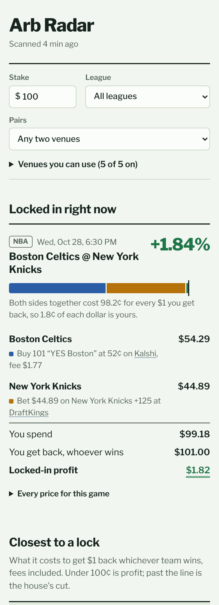

# Arb Radar

Finds **arbitrage between prediction markets and sportsbooks**: moments when buying one team on Kalshi or Polymarket US and the other team at a sportsbook costs less than what you're guaranteed to get back, after fees.

It runs entirely on free resources. GitHub Actions scans every 15 minutes, GitHub Pages hosts the dashboard, and the prices come from public APIs. It never places a trade or a bet; it tells you what to place and where.



*Sample data from the built-in demo.*

## What it checks

| Source | What it adds | Cost |
|---|---|---|
| **Kalshi** public API | Prediction-market prices (YES and NO on each team), order size, fee multiplier per league | Free, no account |
| **Polymarket US** public gateway | Prediction-market prices, re-checked from the order book for promising games | Free, no account |
| **ESPN** scoreboard | The schedule for every league, plus DraftKings' moneyline | Free, no key (unofficial feed) |
| **The Odds API** | FanDuel, BetMGM, Caesars, BetRivers, Fanatics, theScore Bet, Hard Rock Bet, DraftKings | Free plan: 500 credits a month |

Leagues: NFL, NBA, NHL, MLB, college football and college basketball (moneylines).

## How it decides something is an arb

Every price is turned into **what it costs to get $1 back if that team wins, fees included**:

- Kalshi: price + `0.07 × series multiplier × price × (1 − price)` (the multiplier is read from Kalshi; MLB games are 0.5)
- Polymarket US (sports): price + `0.05 × price × (1 − price)`
- Sportsbook: `1 ÷ decimal odds` (the book's cut is already in the odds)

For each game it takes the cheapest venue for each team. If the two costs add up to **less than 100¢**, the difference is locked in no matter who wins. The dashboard draws this as a bar against a 100¢ line.

Example from the demo: YES Boston on Kalshi at 52¢ costs 53.7¢ with the fee. Knicks +125 at DraftKings costs 44.4¢ per $1 back. Together that's 98.2¢, so +1.84%. On a $100 stake that means:

- buy 101 contracts on Kalshi for $54.29, including a $1.77 fee
- bet $44.89 at DraftKings
- get back $101.00 either way, a $1.82 profit

Fees are rounded up to the cent per order and contracts are whole numbers, so the dollar amounts are what you'd really pay.

## Set it up (about 10 minutes, all free)

1. **Create the repository** on GitHub and keep it **public**. Public repos get unlimited free Actions minutes and free Pages. (The dashboard will be public too.)
2. **Get a free Odds API key (optional, recommended).** Sign up for the free plan at [the-odds-api.com](https://the-odds-api.com). In the repo go to **Settings → Secrets and variables → Actions → New repository secret**, name it `ODDS_API_KEY` and paste the key. Without it you still get Kalshi, Polymarket US and DraftKings via ESPN.
3. **Phone alerts (optional).**
   1. Install the free [ntfy](https://ntfy.sh) app.
   2. Subscribe to a long, random topic name, like `arb-radar-7f3k9q2m`. Anyone who knows the name can read it.
   3. Add that name as a secret called `NTFY_TOPIC`.

   A Discord webhook works too: add it as the `DISCORD_WEBHOOK_URL` secret.
4. **Run the first scan:** **Actions → Scan → Run workflow**. It takes about a minute and creates a `gh-pages` branch.
5. **Turn on the website:** **Settings → Pages → Build and deployment → Deploy from a branch → `gh-pages` / `(root)` → Save**. Your dashboard appears at `https://<your-username>.github.io/<repo-name>/` a minute later.

After that it scans by itself every 15 minutes.

## Using the dashboard

- **Stake** changes the stake split for every arb.
- **Venues you can use** turns venues on and off. Your choices are saved on that phone or computer.
- **Pairs** limits the view to prediction market + sportsbook, prediction markets only, or sportsbooks only.
- **Locked in right now** gives each arb as a ledger: what to buy where, how much, the total you spend, what comes back and the profit. It also flags thin order books, stale prices, NFL tie rules and games about to start.
- **Closest to a lock** lists the games nearest to 100¢. Red in parentheses is how far over the dollar they are.
- **Arbs seen in the last two weeks** logs every arb with its peak and how long it lasted.

## Settings

Everything lives in [`config.toml`](config.toml); edit it on GitHub and commit. The most useful ones:

| Setting | What it does |
|---|---|
| `scan.leagues` | Which leagues to scan |
| `scan.stake` | Default stake for the split |
| `scan.min_margin` | Hide arbs smaller than this (0.01 = 1%) |
| `alerts.venues` | Only alert on arbs you can actually place. **If you're under 21, remove the sportsbooks here** and alerts will only fire for Kalshi + Polymarket US pairs |
| `alerts.min_margin` | Minimum locked-in return for a push alert (default 0.5%) |
| `odds_api.reset_day` | The day of the month your free credits reset |
| `odds_api.bookmakers` | Up to 10 books costs 1 credit per call |

## Staying inside the free tiers

- **GitHub Actions** is free for public repositories. A scan takes well under a minute.
- **The Odds API** has 500 credits a month, and each call costs 1 credit. The scanner calls a sport only when a game starts within 36 hours. It waits 90 minutes between calls (45 near game time) and never spends more than `credits left ÷ days left` in a day. Between calls the last odds are reused and shown with their age.
- **Kalshi, Polymarket US and ESPN** are free public endpoints. A scan makes a few dozen requests in total.
- **gh-pages** holds a single commit that is replaced each run, so the repository doesn't grow.

## Honest limits

- **Real arbs are rare and short.** Most days show none, and the ones that appear often last minutes. Checking every 15 minutes is slow next to paid tools. Treat an alert as a prompt to check, not a guarantee.
- **Confirm before you act.** Check both prices on the venues themselves and place the thinner side first. If either price moved, stop.
- **Rules differ between venues.** An NFL tie refunds a 2-way sportsbook bet, but a YES contract loses. Postponements are also handled differently. Read both rules.
- **Sportsbooks** require age 21+ in Illinois and most states. They also tend to limit accounts that only take arbs.
- **The ESPN feed is unofficial** and could change without notice. The dashboard's "Where the prices come from" section shows each source's health. `data/debug.json` on your site holds a raw sample from each feed for troubleshooting.
- **Scheduled workflows pause** if a public repo has no activity for 60 days. GitHub emails you, and you can re-enable it from the Actions tab.

This is a personal tool, not financial advice.

## Run it on your own computer (optional)

Needs Python 3.11+ and nothing else:

```bash
python3 -m arb --demo --out site      # sample data, no internet
cp -R web/. site/ && python3 -m http.server -d site 8000
# open http://localhost:8000

ODDS_API_KEY=... python3 -m arb --out site   # live data
python3 -m unittest discover -s tests        # tests
```

## Project layout

```
arb/                  the scanner (Python standard library only)
  sources/            kalshi.py, polymarket_us.py, espn.py, odds_api.py
  matching.py         lines up the same game across sources
  engine.py           arb math and stake split
  fees.py             Kalshi and Polymarket US fee formulas
  budget.py           spends The Odds API credits evenly
  pipeline.py         one full scan
web/                  the dashboard (plain HTML, CSS and JavaScript)
tests/                unit tests, sample API responses, dashboard math check
.github/workflows/    scan.yml (every 15 min) and tests.yml
config.toml           your settings
```
